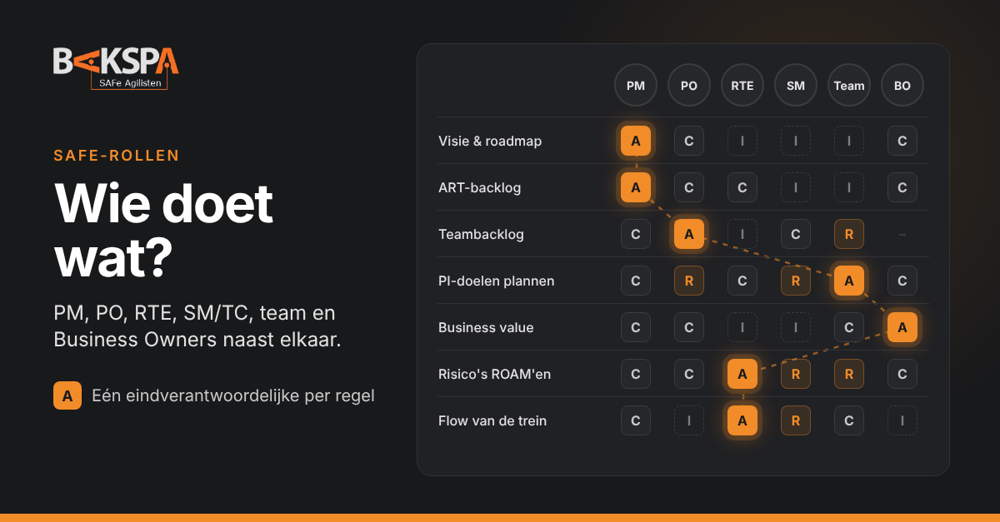

"Is dat nou de PO of de PM?" Het is een van de meest gestelde vragen in mijn trainingen. Product Manager, Product Owner, Release Train Engineer en Scrum Master/Team Coach werken nauw samen, en juist daardoor lopen hun verantwoordelijkheden in de praktijk vaak door elkaar.

<!-- truncate -->

SAFe® beschrijft per rol wat er van je verwacht wordt, maar publiceert geen RACI. Ik heb er daarom een gemaakt op basis van de officiële trainingen die ik geef: **AI-Empowered SAFe® POPM**, **Agile Product Management**, **AI-Empowered Release Train Engineer** en **AI-Empowered Advanced Scrum Master**. Waar de trainingen ruimte laten, heb ik gekozen op basis van wat ik als RTE in de praktijk zie werken. Gebruik hem als startpunt voor het gesprek in je eigen ART, niet als wet.

## De rollen in het kort

- **Product Management (PM)** bepaalt *wat* de ART levert en waarom. PM verkent markt en klant, vertaalt de portfoliostrategie naar visie en roadmap, en is eigenaar van de ART-backlog met features. In grotere ART's is PM vaak een functie die door meerdere mensen wordt ingevuld.
- **Product Owner (PO)** is de stem van de klant in het team. De PO draagt bij aan visie en roadmap, is eigenaar van de teambacklog, ondersteunt het team tijdens de uitvoering en zorgt dat feedback terugvloeit. De PO accepteert de stories.
- **Release Train Engineer (RTE)** is de servant leader en *chief coach* van de ART. Waar PM over het *wat* gaat, gaat de RTE over *hoe de waarde door het systeem stroomt*: de ART-events faciliteren, risico's en afhankelijkheden zichtbaar maken en obstakels op ART-niveau wegnemen.
- **Scrum Master/Team Coach (SM/TC)** doet dat voor het team. De basis is PI Planning faciliteren en de iteraties ondersteunen. Een ervaren SM werkt daarnaast aan flow, aan een high-performing team en aan de prestaties van de hele ART.
- **Het team** plant zelf, committeert zich zelf aan zijn PI-doelen en is zelf verantwoordelijk voor het integreren en opleveren van werkende software. Een tabel met alleen "de rollen" vergeet vaak dat de A hier meestal bij het team ligt.
- **Business Owners (BO)** zijn de belangrijkste stakeholders van de ART. Ze kennen business value toe aan de PI-doelen en blijven ook na PI Planning betrokken.

## De RACI

<RaciLegenda />

| Activiteit | PM | PO | RTE | SM/TC | Team | BO |
|---|---|---|---|---|---|---|
| **Inhoud en prioriteit** |  |  |  |  |  |  |
| Visie en roadmap van de oplossing | A | C | I | I | I | C |
| Klant en markt verkennen, inzichten vertalen | A | R | – | – | C | C |
| ART-backlog: features opstellen en prioriteren (WSJF) | A | C | C | I | I | C |
| Teambacklog: stories opstellen en prioriteren | C | A | I | C | R | – |
| Stories accepteren (Definition of Done) | I | A | – | I | R | – |
| **PI Planning** |  |  |  |  |  |  |
| Event voorbereiden en faciliteren | R | C | A | R | I | C |
| Business context en visie presenteren | A | I | C | I | I | R |
| Team breakouts: plan en PI-doelen opstellen | C | R | C | R | A | C |
| Business value toekennen aan PI-doelen | C | C | I | I | C | A |
| Risico's ROAM'en | C | C | A | R | R | C |
| Commitment via de confidence vote | I | R | R | R | A | I |
| **PI-uitvoering** |  |  |  |  |  |  |
| Iteratie-events: planning, Team Sync, review, retro | – | R | I | R | A | – |
| Coach Sync | – | – | A | R | – | – |
| PO Sync | A | R | R | – | – | I |
| Obstakels op teamniveau wegnemen | – | C | I | A | R | – |
| Obstakels op ART-niveau wegnemen en escaleren | C | I | A | R | I | C |
| **Demo en verbetering** |  |  |  |  |  |  |
| Werk integreren voor de System Demo | I | R | C | C | A | – |
| Features beoordelen in de System Demo | A | R | C | I | C | C |
| Inspect & Adapt | R | R | A | R | R | R |
| Flow meten en verbeteren in het team | – | C | I | A | R | – |
| Flow en voorspelbaarheid van de ART verbeteren | C | I | A | R | C | I |

*Wie A is, voert meestal ook (een deel) uit. Ik toon dan alleen de A, zodat de tabel leesbaar blijft. De System Architect en het System Team laat ik hier buiten beschouwing; zij verdienen een eigen artikel.*

## Vier patronen die ik vaak tegenkom

### 1. De PM als superPO

De Product Manager schrijft zelf stories en zit bij elke refinement. Het voelt betrokken, maar het team weet niet meer wie er beslist, en de PO verliest zijn mandaat. Houd het onderscheid scherp: PM gaat over features en de ART-backlog, de PO over stories en de teambacklog. Ze werken intensief samen, in de PO Sync, bij de voorbereiding van PI Planning en bij het ophalen van feedback, maar ieder heeft een eigen backlog.

### 2. De RTE als projectmanager

De RTE bewaakt deadlines, verdeelt werk en wijst eigenaren aan voor elk risico. Dat is niet de rol. Bij het ROAM'en van risico's faciliteert de RTE het gesprek; het eigenaarschap ligt bij wie het risico het best kan oppakken. Een tweede valkuil: alles zelf doen. Een goede RTE delegeert, bijvoorbeeld de PI System Demo aan PM en PO's en het verzamelen van metrics aan de Scrum Masters, en blijft zelf de coach van het geheel.

### 3. De Scrum Master als secretaris

De SM plant meetings, werkt het bord bij en maakt notulen. Allemaal nuttig, maar daarmee blijft de rol steken op het fundament. De meerwaarde zit in de gevorderde gebieden: knelpunten in de flow zichtbaar maken en oplossen, een team bouwen dat zelf verbetert en conflicten aankan, en kijken naar de prestaties van de hele ART in plaats van alleen het eigen team.

### 4. De Business Owner die alleen op dag één verschijnt

Business Owners presenteren de context, kennen business value toe en verdwijnen dan tot de volgende PI Planning. Actieve betrokkenheid van Business Owners is een kritische succesfactor: bij demo's, bij het valideren van MVP's en bij Inspect & Adapt. Gebeurt dat niet, dan is het aan de RTE om dat aan te kaarten en zo nodig als impediment te escaleren.

## Waar AI hier in past

In de AI-Empowered versies van de trainingen krijgt elke rol AI als hulpmiddel: als tool, als bron om van te leren en als sparringpartner. Een PO kan stories en acceptatiecriteria laten voorbereiden, een RTE kan de input voor PI Planning laten samenvatten of scenario's verkennen, en een SM kan een lastig coachingsgesprek eerst oefenen.

Wat de trainingen ook duidelijk maken: AI ondersteunt de voorbereiding, maar vervangt de samenwerking niet. PI Planning blijft een menselijk event, en teams en leiders blijven verantwoordelijk voor commitments en beslissingen. Hoe meer je AI zelfstandig laat handelen, bijvoorbeeld met agents, hoe groter juist de verantwoordelijkheid van de mens die dat toestaat. In RACI-termen: AI kan R of C zijn, maar de A blijft altijd bij een mens.

## Zelf aan de slag

Leg deze tabel naast de werkelijkheid in je eigen ART. Waar staan er twee A's in één regel? Waar staat er geen? En waar staat de A bij een rol terwijl hij eigenlijk bij het team hoort? Daar zitten meestal de frustraties. Bespreek het in je volgende Inspect & Adapt, of plan een korte sessie met PM, PO's, RTE, SM's en een Business Owner.

<Cta titel="Deze rollen leren invullen?">

Dit artikel is gebaseerd op de trainingen die ik geef: AI-Empowered POPM, Agile Product Management, AI-Empowered Release Train Engineer en AI-Empowered (Advanced) Scrum Master. In-house of privé, met jullie eigen ART als casus.

</Cta>

<DeelOpLinkedIn tekst="Nuttig?" />

