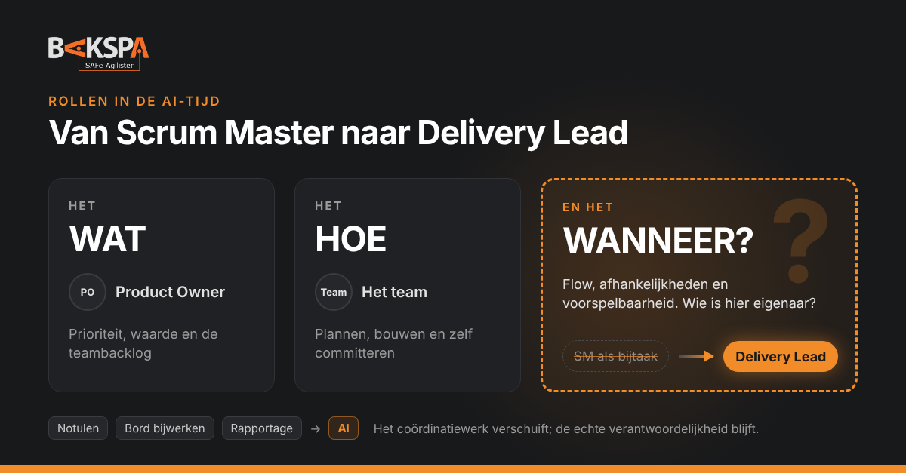

Ik zie twee bewegingen in de markt die op het eerste gezicht niets met elkaar te maken hebben. Bedrijven laten de dedicated Scrum Master los. En tegelijk groeit, zeker onder zelfstandigen, de vraag naar Delivery Leads. Volgens mij zijn het twee kanten van hetzelfde verhaal.

<!-- truncate -->

## Wat ik zie

De Scrum Master wordt steeds vaker een bijtaak. Een developer in het team "doet het er wel even bij": de daily leiden, de retro organiseren, het bord bijhouden. Een volwaardige rol is het niet meer, en een budgetpost ook niet.

Tegelijk zie ik in opdrachten en aanvragen een ander profiel opduiken: de Delivery Lead. Als je de functieomschrijving naast die van een Scrum Master legt, lijken ze sterk op elkaar: faciliteren, obstakels wegnemen, samenwerking tussen teams, continu verbeteren. Met één groot verschil: een Delivery Lead heeft een expliciete *delivery*-verantwoordelijkheid. Er wordt van je verwacht dat je zorgt dat er geleverd wordt, en dat je weet wanneer.

Ik ben niet de enige die dit ziet. Echometer, een leverancier van tools voor Agile teams, schrijft dat [klanten steeds vaker een developer als parttime Scrum Master aanwijzen](https://echometerapp.com/en/obsolete-do-we-really-need-a-scrum-master/), en betwijfelt of dat werkt. Volgens dezelfde bron is de [Agile Delivery Manager al sinds 2023 een trend](https://echometerapp.com/en/what-is-a-agile-delivery-manager/): met de gestegen rente willen veel bedrijven niet langer betalen voor een Scrum Master die vooral teamcoach of "feel-good-manager" is geworden.

## Het gat: wat, hoe en wanneer

Vroeger was het simpel. Er was een projectleider of projectmanager die van begin tot eind verantwoordelijk was. Die regelde het allemaal: scope, planning, budget, mensen. Of dat altijd goed ging, is een ander verhaal, maar iedereen wist bij wie hij moest zijn.

In een Agile organisatie is dat verdeeld. De Product Owner gaat over het **WAT**. Het team gaat over het **HOE**. Maar het **WANNEER** wordt vaak een beetje losjes. De PO zegt dat het team de planning maakt, het team zegt dat de PO de prioriteit bepaalt, en de Scrum Master, als die er nog is, zegt dat hij faciliteert en niet stuurt.

En dan gaat het management op zoek. Niet naar meer agility, maar naar iemand die aanspreekbaar is als het te laat is. Eerlijk gezegd: naar een kop van jut.

Natuurlijk kun je zeggen dat zo'n bedrijf dan niet echt Agile is. Dat klopt vaak ook. Maar de meeste organisaties zijn een mix van werelden en culturen: een deel werkt in treinen en teams, een deel in projecten, en de financiering en de klant denken nog in mijlpalen. Dat is gewoon de werkelijkheid waarin we werken.

## Wat SAFe® er zelf over zegt

Het interessante is dat het WANNEER in SAFe® helemaal niet losjes is. In mijn [RACI van PM, PO, RTE en SM](/blog/raci-pm-po-rte-sm) zie je dat het op een aantal plekken expliciet belegd is:

- **Cadans**: iteraties en PI's geven een vast ritme. Het wanneer van plannen, demonstreren en verbeteren ligt vast.
- **PI-doelen**: het team committeert zich zelf aan zijn doelen voor de komende PI, met een confidence vote. Business Owners kennen er business value aan toe.
- **Voorspelbaarheid**: aan het eind van de PI wordt gemeten in hoeverre de trein heeft waargemaakt wat hij beloofde. Dat is een van de sterkste middelen om vertrouwen op te bouwen tussen Business Owners en teams.
- **Releasemoment**: Product Management bepaalt wanneer waarde naar de markt gaat. Releasen kan op elk moment, los van de cadans.
- **Flow**: op treinniveau is de RTE eindverantwoordelijk voor flow en voorspelbaarheid. Op teamniveau is dat de Scrum Master/Team Coach.

Daar zit volgens mij de kern. Het gat rond het WANNEER ontstaat precies op de plek waar de Scrum Master een bijtaak wordt. De developer die het erbij doet, faciliteert de events, maar heeft geen tijd, mandaat en vaak ook geen zin om flow, afhankelijkheden en voorspelbaarheid te bewaken. Die verantwoordelijkheid verdampt, en dan komt de vraag naar een Delivery Lead.

## Wat AI verandert

In de nieuwe AI-Empowered (Advanced) Scrum Master-training begint het verhaal met de vraag hoe de rol is veranderd en nog verandert. AI is daarin geen bedreiging, maar een gereedschap: om dagelijkse taken te versnellen, om van te leren en als sparringpartner. De Scrum Master moet daarbij zelf voorop lopen, zodat hij het team kan helpen AI goed in te zetten.

Buiten SAFe® klinkt dezelfde vraag, en soms een stuk scherper. Op Scrum.org voorspelt Professional Scrum Trainer Mehdi Hoseini dat [AI de Scrum Master harder raakt dan de andere rollen](https://www.scrum.org/node/106977): kleinere teams hebben minder facilitatie nodig, één Scrum Master krijgt meer teams, en de rol in zijn klassieke vorm verdwijnt misschien zelfs. De meeste stemmen zijn genuanceerder: [AI neemt het administratieve werk over](https://agilemania.com/is-the-scrum-master-role-dying), maar coacht geen team, lost geen conflicten op en leidt geen organisatieverandering.

Daar zit een ongemakkelijke waarheid in. Een groot deel van wat veel Scrum Masters vandaag doen is coördinatie: het bord bijwerken, notulen maken, voortgang verzamelen, rapporteren. Juist dat werk kan AI steeds beter overnemen. Wie zijn rol daarop heeft gebouwd, maakt het bedrijven makkelijk om te zeggen: dat kan een developer er wel bij doen.

Wat overblijft is precies wat de training de gevorderde kant van de rol noemt: knelpunten in de flow vinden en oplossen, een team bouwen dat zelf verbetert en conflicten aankan, en kijken naar de prestaties van de hele trein in plaats van alleen het eigen team. Dat is geen bijtaak. En het is precies wat je nodig hebt om het WANNEER waar te maken.

En er komt iets nieuws bij: AI moet in het team zelf ook bestuurd worden. Welke tools gebruiken we, welke data mag erin, wie controleert de output? Scrum.org benadrukt dat [de keuze voor AI-tools een beslissing van het team is](https://www.scrum.org/resources/blog/10-scrum-master-interview-questions-ai-era), niet van één persoon of van het management, en dat de Scrum Master die beslissing faciliteert. Ook dat is uiteindelijk een delivery-vraag: wie bewaakt dat sneller niet slordiger wordt?

## Scrum Master, Delivery Lead of projectmanager?

|   | Projectmanager | Scrum Master als bijtaak | Delivery Lead |
|---|---|---|---|
| Focus | Plan, scope en budget | De events laten plaatsvinden | Voorspelbare levering en flow |
| Gaat over het wanneer | Ja, bepaalt het | Nee, niemand eigenlijk | Ja, maakt het zichtbaar en waar |
| Wie committeert | De projectmanager, namens het team | Het team, maar niemand bewaakt het | Het team, de Delivery Lead bewaakt het |
| Stuurt via | Opdrachten en planning | Faciliteren | Transparantie, flow-metrics, afhankelijkheden en coaching |
| Valkuil | Command & control | Verantwoordelijkheid verdampt | Ongemerkt weer projectmanager worden |

## Mijn standpunt

Moeten we de Scrum Master dan Delivery Lead gaan noemen in plaats van Team Coach? Ik denk dat de markt die vraag al aan het beantwoorden is. En ik denk dat dat niet erg is, zolang we twee dingen goed doen.

**Eén: geef de rol een echte A.** Een Delivery Lead is eindverantwoordelijk voor flow en voorspelbaarheid van het team: dat het WANNEER zichtbaar is, dat afhankelijkheden en risico's op tijd op tafel komen, en dat het team waarmaakt wat het belooft, of op tijd laat weten dat dat niet lukt. Dat is geen nieuwe verantwoordelijkheid. Het is wat SAFe® al bij de Scrum Master/Team Coach legt, alleen nu hardop gezegd.

**Twee: maak er geen projectmanager van.** Het team blijft zelf committeren aan zijn doelen. De PO en Product Management blijven over het wat en het releasemoment gaan. De Delivery Lead neemt die beslissingen niet over, maar zorgt dat ze op tijd en op basis van echte data worden genomen. Wie de rol gebruikt als kop van jut, krijgt binnen een paar maanden een projectmanager met een nieuwe titel terug.

De naam doet er uiteindelijk minder toe dan de verantwoordelijkheid. Maar als "Delivery Lead" organisaties helpt om weer iemand echt eigenaar te maken van flow en voorspelbaarheid, en de Scrum Master helpt om zijn waarde te laten zien in een tijd waarin AI het coördinatiewerk overneemt, dan is het een naam die ik graag gebruik.

Hoe zie jij dat? Is de Scrum Master in jouw organisatie al een bijtaak geworden, en wie bewaakt daar het WANNEER?

<Cta titel="De rol een echte A geven?">

In de AI-Empowered SAFe® Scrum Master- en Advanced Scrum Master-training gaat het precies hierover: flow, voorspelbaarheid, high-performing teams en de rol in het AI-tijdperk. Voor de trein als geheel is er de AI-Empowered Release Train Engineer-training. In-house of privé, met jullie eigen situatie als casus.

</Cta>

<DeelOpLinkedIn tekst="Herkenbaar?" />

## Bronnen

- [Echometer – Obsolete? Do we really need a Scrum Master?](https://echometerapp.com/en/obsolete-do-we-really-need-a-scrum-master/)
- [Echometer – The most important Agile delivery roles](https://echometerapp.com/en/what-is-a-agile-delivery-manager/)
- [Scrum.org – AI Future Impact On The Scrum Roles (Mehdi Hoseini)](https://www.scrum.org/node/106977)
- [Agilemania – Is the Scrum Master Role Dying in 2026?](https://agilemania.com/is-the-scrum-master-role-dying)
- [Scrum.org – 10 Scrum Master Interview Questions for the AI Era](https://www.scrum.org/resources/blog/10-scrum-master-interview-questions-ai-era)
- Scaled Agile, Inc. – AI-Empowered SAFe® (Advanced) Scrum Master en SAFe® Release Train Engineer (cursusmateriaal)

*Lees ook: [Scrum Master… is je rol nog nodig?](/blog/scrum-master-rol-nog-nodig) · [Wie doet wat? PM, PO, RTE en SM in één RACI](/blog/raci-pm-po-rte-sm)*

